<div align="center">


# Vishwajeet Team [AI Company]

### Agent harness to run an office of your clones

<p>
  <a href="./LICENSE"></a>
  <a href="./CHANGELOG.md"></a>
  
  
  <a href="https://github.com/Vishwajeetsrk/Vishwajeet-Team/releases"></a>
  
</p>


**Free, open source and performant.** A multi-agent harness that works with the
subscriptions you already pay for, on their hourly limits. It turns the terminal coding CLI
you already run into a clone of you, one that keeps working while you're away and
coordinates a whole office of agents on your own machine.

Wraps [Claude Code](https://claude.com/claude-code), Antigravity (Gemini), OpenAI Codex,
**xAI Grok**, **Kimi Code**, **Gemini CLI**, **Qwen**, **OpenCode**, **Crush**,
**pi.dev**, **GitHub Copilot CLI**, and **Cursor**, with bring-your-own keys and local LLMs.
Agents that message, route, and remember, coordinated by **your clone** (Michael) and
visualized as avatars at work on a shared office floor.

<p>
  <em>Electron · React · TypeScript · Pixi.js · xterm.js · node-pty</em>
</p>

<br>

<div align="center">
  <video
    src="YOUR_GITHUB_USER_ATTACHMENT_URL_HERO"
    width="820"
    controls
    preload="metadata">
  </video>
  <br>
  <sub>▶ Vishwajeet Team — 1080p 60fps video walkthrough</sub>
</div>

### ⬇ Downloads & Installers (v0.6.0)

| Platform | Format | Direct Download |
|:---|:---|:---|
| 🍏 **macOS** | Universal DMG (Apple Silicon + Intel) | [macOS Universal DMG](https://github.com/Vishwajeetsrk/Vishwajeet-Team/releases/download/v0.6.0/Vishwajeet-Team-0.6.0-mac-universal.dmg) |
| 🪟 **Windows** | Setup Installer (x64) | [Windows x64 Setup Installer](https://github.com/Vishwajeetsrk/Vishwajeet-Team/releases/download/v0.6.0/Vishwajeet-Team-0.6.0-win-x64-setup.exe) |
| 🪟 **Windows** | Portable (.exe, no install) | [Windows x64 Portable (.exe)](https://github.com/Vishwajeetsrk/Vishwajeet-Team/releases/download/v0.6.0/Vishwajeet-Team-0.6.0-win-x64-portable.exe) |
| 🐧 **Linux** | AppImage (x86_64) | [Linux AppImage](https://github.com/Vishwajeetsrk/Vishwajeet-Team/releases/download/v0.6.0/Vishwajeet-Team-0.6.0-linux-x86_64.AppImage) |

<sub>100% Free · Local-First · No Account · No Paywall · [All Release Assets & Checksums](https://github.com/Vishwajeetsrk/Vishwajeet-Team/releases/tag/v0.6.0)</sub>

</div>

---

> [!NOTE]
> **The world's best agents. One office. One boss.**
> Vishwajeet Team takes the terminal-agent CLIs you already run (`claude`, `agy`, `codex`, `grok`,
> `kimi`, `qwen`, `opencode`, `crush`, `pi`, and `copilot`) and turns them
> into a self-coordinating team: each agent gets long-term memory, a mailbox, and a desk on a 2D
> office floor, and **your clone** (Michael) routes work between them while you watch. He's the
> boss of the floor; you're still the boss of him.

## Contents

- [Downloads & Installers](#-downloads--installers-v060)
- [Pricing: 100% Free](#pricing-100-free)
- [Supported agents](#supported-agents)
- [What it is](#what-it-is)
- [How it works](#how-it-works)
- [Features showcase](#features-showcase)
- [Features](#features)
- [Getting started](#getting-started)
- [Architecture & project structure](./docs/ARCHITECTURE.md)
- [Roadmap](#roadmap)
- [Contributing](#contributing)
- [Telemetry](#telemetry)
- [License](#license)
- [Acknowledgements](#acknowledgements)

## Pricing: 100% Free

**Vishwajeet Team [AI Company]** is completely free, local-first, and open-source under the MIT License. In the original upstream prototype, a subscription paywall ($150/yr) called "Pro" was planned to restrict features. In **Vishwajeet Team**, every single Pro and Team feature is **100% UNLOCKED BY DEFAULT**.

### ⚡ Why Is There No "Pro Switch" or "Team Switch"?
* **Zero Paywalls & No License Keys:** There is NO switch, license key prompt, or paywall gate because you are never locked out of anything. You never need to enter a credit card, activate a key, or upgrade a tier.
* **All Features Enabled Out-of-the-Box:** Unlimited agents, multi-agent floor orchestration, the hive memory palace, autonomous mode, Stapler desktop companion, and all integrations are completely free and permanently enabled.
* **The "Classic" Button is a View Switcher:** The toggle at the top right labeled **`Classic`** is an **Interface Mode Switch**, not a license gate. It lets you instantly switch between the **2D Pixel-Art Office Floor** (with desks, avatars, and real-time movement) and the **Modern Workspace Dashboard** (Capabilities catalog, Automations, Memory Palace, Integrations, and Stapler settings).

| Feature Tier | Upstream Prototype | Vishwajeet Team (Your Build) |
| :--- | :--- | :--- |
| **Price** | $150 / year | **$0 / Free Forever** |
| **Agent Capacity** | Capped on Free tier | **Unlimited parallel agents** |
| **Orchestration** | Single agent | **Multi-agent autonomous floor** |
| **Capabilities** | Limited access | **2,347+ MCP servers, skills & plugins** |
| **Stapler Desktop HUD** | Paywalled | **100% Unlocked & customizable** |
| **Integrations Hub** | Restricted | **Zero-restart hot keys for all providers** |

- **Free Core**: All terminal-agent CLIs, BYOK keys, local LLMs (Ollama / LM Studio / vLLM), and persistent computers.
- **Pro Features**: Unlimited parallel agents, autonomous execution mode, Monaco IDE, voice dictation & speech orchestration, context auto-compacting, and circuit breakers.
- **Team Capabilities**: Multi-agent delegation, agent-to-agent mailboxes, shared blackboard, scheduled triggers, and job ledgers.
- **Zero Telemetry**: Everything stays on your computer. All prompts, code, keys, and outputs remain strictly local.

## Supported agents

**Bring the CLI you already pay for.** Every one of these runs as a real process in its own
terminal, with your existing subscription and its hourly limits. If it runs in a terminal, it
can run here.

<p>
  <a href="https://docs.claude.com/en/docs/claude-code"><kbd>Claude Code</kbd></a>
  <a href="https://github.com/openai/codex"><kbd>Codex · GPT</kbd></a>
  <a href="https://x.ai/cli"><kbd>Grok · xAI</kbd></a>
  <a href="https://www.kimi.com/code"><kbd>Kimi Code</kbd></a>
  <a href="https://github.com/google-gemini/gemini-cli"><kbd>Gemini CLI</kbd></a>
  <a href="https://antigravity.google/docs/cli-overview"><kbd>Antigravity · Gemini</kbd></a>
  <a href="https://github.com/QwenLM/qwen-code"><kbd>Qwen</kbd></a>
  <a href="https://opencode.ai/docs"><kbd>OpenCode</kbd></a>
  <a href="https://github.com/charmbracelet/crush"><kbd>Crush · Charm</kbd></a>
  <a href="https://pi.dev/docs/latest"><kbd>Pi</kbd></a>
  <a href="https://docs.github.com/copilot/concepts/agents/about-copilot-cli"><kbd>GitHub Copilot</kbd></a>
  <a href="https://cursor.com/docs/cli/install"><kbd>Cursor</kbd></a>
  <kbd>+ any custom command</kbd>
</p>

Plus **bring your own keys** and **local models** through Ollama, LM Studio or vLLM.

## What it is

Vishwajeet Team is a desktop app that wraps **real terminal-agent CLIs** as fully-capable agents,
wires them into a **hive mind**, and puts **your clone** in charge. Michael is the one agent *you*
talk to in order to get things done. Under the hood it runs the **fastest memory layer in the
world** so every agent remembers what it learns and recalls it instantly.

- **Every terminal is an agent.** Each `claude`, `agy`, `codex`, `grok`, `kimi`, `qwen`, `opencode`, `crush`, `pi`, `copilot`, or custom session runs as a real
  process in a pseudo-terminal (`node-pty`), byte-for-byte authentic, rendered with xterm.js.
- **Every agent is an avatar.** Sessions appear as characters on a Pixi.js office floor. They walk
  to stations as they work, and envelopes fly desk-to-desk when they message each other.
- **The hive coordinates them.** Agents read their memory and drain a mailbox; the router moves
  messages between inboxes; the GOD agent adjudicates, assigns, and escalates only when it needs you.
- **Memory that's instant.** A markdown-first memory layer with a semantic recall index means agents
  remember across sessions and recall in milliseconds.

## How it works

```
            you ── talk to ──►  ┌─────────────┐
                                │  GOD agent  │  orchestrator / supervisor
                                │ (Michael's  │  roster · routing · adjudication
                                │   office)   │  blackboard · task ledger
                                └──────┬──────┘
                                       │ assigns · routes · escalates
              ┌────────────────────────┼────────────────────────┐
              ▼                         ▼                         ▼
        ┌───────────┐            ┌───────────┐            ┌───────────┐
        │  agent A  │  message   │  agent B  │  message   │  agent C  │
        │ provider  │ ─────────► │ provider  │ ─────────► │ provider  │
        │  + memory │            │  + memory │            │  + memory │
        └───────────┘            └───────────┘            └───────────┘
              └──────── shared hive: memory · mailbox · blackboard · log ───────┘
```

1. **You spawn agents**: each is a normal terminal process (`claude`, `agy`, `codex`, or custom)
   with its own working directory, identity, and provider-specific lifecycle.
2. **Agents collaborate through the hive**: a local git repo of plain files. They write to their own
   `outbox/`; the harness's router delivers into recipients' `inbox/`. No agent ever touches git
   (single-committer design avoids `index.lock` corruption).
3. **The GOD agent runs the floor**: it reads every request, resolves routine ones itself (keeping
   the system fully autonomous), and only escalates *critical* items (spend, destructive ops, scope
   changes) into an approvals queue you act on.
4. **Everything is visible**: you watch avatars move, envelopes fly, and the live terminal stream;
   you can type back into any session, browse its files, and read its git history.

See [`HIVE.md`](./HIVE.md) for the full multi-agent design, [`SPEC.md`](./SPEC.md) for the
terminal/event plane, and [`DESIGN.md`](./DESIGN.md) for the visual system.

## Features Showcase

> Real screen recordings of every feature — click any thumbnail to watch.

<table>
<tr>
<td width="48%" valign="top">

### 🎙️ Dictate into Any App & Stapler Meetings
`Local Audio` · `On-Device Whisper` · `Dual-Channel Meetings` · `100% Free & Pro Unlocked`

<p>
  <kbd>🎙️ Local Whisper Engine</kbd> 
  <kbd>⚡ Zero Latency Push-to-Talk</kbd> 
  <kbd>👥 Dual-Channel Recording</kbd> 
  <kbd>🔒 100% Private (No Cloud)</kbd>
</p>

* **🗣️ Dictate into any app.** Hold Option on the Mac, or Control+Alt+Space on Windows and Linux (X11), talk, and let go. The words land in whatever field is in front of you, and in every text box inside Munder Difflin. The message box mic works in the free build too.
  * 🍏 **macOS:** Hold <kbd>⌥ Option</kbd>
  * 🪟 **Windows & Linux (X11):** Hold <kbd>Ctrl</kbd> + <kbd>Alt</kbd> + <kbd>Space</kbd>

* **🎧 Meetings hear both sides**, in Stapler, part of Pro. Your microphone is written as You and the call's audio as Them, on Mac, Windows and Linux. Shift+Command+Space starts and stops a meeting on the Mac, Control+Shift+Space on Windows and Linux. Correct the transcript, add a description, and send it to any of your agents.
  * 🍏 **macOS:** <kbd>⇧ Shift</kbd> + <kbd>⌘ Cmd</kbd> + <kbd>Space</kbd> to start/stop
  * 🪟 **Windows & Linux:** <kbd>Ctrl</kbd> + <kbd>Shift</kbd> + <kbd>Space</kbd> to start/stop

* **⚡ Transcription on your machine.** A Whisper model ships inside the app and is the default engine. A larger model is one download away, Apple's on device recogniser works on macOS 26, and Groq stays off unless you add a key. 126 built in technical names plus your own words. English for now.

<br>

<div align="center">
  
  <br><sub><b>Stapler:</b> The yellow puck, with its ring open and Record meeting ready.</sub>
  <br><br>
  <video
    src="YOUR_GITHUB_USER_ATTACHMENT_URL_PRO_STAPLER"
    width="100%"
    controls
    preload="metadata">
  </video>
  <br>
  <sub>▶ Stapler Dual-Channel Meeting Recording Demo</sub>
</div>

</td>
<td width="52%" align="center">

<div align="center">
  <video
    src="YOUR_GITHUB_USER_ATTACHMENT_URL_DICTATION"
    width="100%"
    controls
    preload="metadata">
  </video>
  <br>
  <sub>▶ Push-to-talk dictation demo</sub>
</div>

</td>
</tr>
<tr>
<td width="48%" valign="top">

### 🃏 One Row Per Agent, Live Visibility
`Agent HUD` · `Context Gauge` · `Real-time Activity` · `Command Center`

Agent cards display status, engine, model, a real-time context gauge, active tickets, and immediate actions. Features an inline crash strip instead of a silent terminal, and right-click actions for common jobs.

> *Command Center tabs cover Tasks, Ask Me, Triggers, Memory, Skills, and Workforce — fully unlocked.*

</td>
<td width="52%" align="center">

<div align="center">
  <video
    src="YOUR_GITHUB_USER_ATTACHMENT_URL_AGENT_CARDS"
    width="100%"
    controls
    preload="metadata">
  </video>
  <br>
  <sub>▶ Agent cards HUD demo</sub>
</div>

</td>
</tr>
<tr>
<td width="48%" valign="top">

### 🧠 Talk to One Agent, Not Twelve
`Orchestrator Clone` · `Autonomous Delegation` · `Traffic Routing`

Michael is your direct clone and the single agent you brief. He breaks down goals, assigns tasks, coordinates the workforce, routes message traffic, and only escalates what truly requires your approval.

> *Delegate complex multi-repo goals with a single sentence.*

</td>
<td width="52%" align="center">

<div align="center">
  <video
    src="YOUR_GITHUB_USER_ATTACHMENT_URL_ORCHESTRATOR"
    width="100%"
    controls
    preload="metadata">
  </video>
  <br>
  <sub>▶ Orchestrator agent briefing demo</sub>
</div>

</td>
</tr>
<tr>
<td width="48%" valign="top">

### ➕ Hire an Agent in a Few Clicks
`Multi-Model Picker` · `Custom Personas` · `Agent Gallery`

Pick your provider (Claude, Grok, Codex, Gemini, DeepSeek, or local Ollama), configure the autonomy leash, assign a desk, and work begins. Import roles directly from the [Agent Gallery](https://github.com/Vishwajeetsrk/Vishwajeet-Team/tree/main/docs/hires).

> *Instant spawn with preconfigured system prompts, tools, and skills.*

</td>
<td width="52%" align="center">

<div align="center">
  <video
    src="YOUR_GITHUB_USER_ATTACHMENT_URL_HIRE_AGENT"
    width="100%"
    controls
    preload="metadata">
  </video>
  <br>
  <sub>▶ Hiring agents demo</sub>
</div>

</td>
</tr>
<tr>
<td width="48%" valign="top">

### 🧩 Memory That Survives the Session
`Shared Knowledge Base` · `Markdown Palace` · `Cross-Agent Recall`

Every agent logs structured Markdown memory continuously indexed into a shared, searchable Knowledge Palace. Close the app, restart tomorrow, and your entire workforce remembers what they built and learned.

> *Zero context rot across projects and long-running development sprints.*

</td>
<td width="52%" align="center">

<div align="center">
  <video
    src="YOUR_GITHUB_USER_ATTACHMENT_URL_MEMORY"
    width="100%"
    controls
    preload="metadata">
  </video>
  <br>
  <sub>▶ Shared memory palace demo</sub>
</div>

</td>
</tr>
<tr>
<td width="48%" valign="top">

### 🔒 Autonomy With a Leash
`Circuit Breaker` · `Spend Caps` · `Human-in-the-Loop`

Control the autonomy perimeter for every desk. Scope increases, API spend thresholds, and destructive file operations pause for your approval. Built-in circuit breakers halt runaway loops automatically.

> *True autonomy with complete peace of mind and strict safety guardrails.*

</td>
<td width="52%" align="center">

<div align="center">
  <video
    src="YOUR_GITHUB_USER_ATTACHMENT_URL_AUTONOMY"
    width="100%"
    controls
    preload="metadata">
  </video>
  <br>
  <sub>▶ Autonomy leash and circuit breaker demo</sub>
</div>

</td>
</tr>
<tr>
<td width="48%" valign="top">

### 👀 Watch the Whole Floor Work
`Spatial Canvas` · `Pixel Art Office` · `Live Terminals` · `Two-Way I/O`

Agents walk between desks, workstations, and meeting rooms as they execute tasks. Message envelopes fly between colleagues in real time. Click any desk to inspect that terminal live and send keystrokes directly into its session.

> *Spatial workplace visualization brings your agent team to life.*

</td>
<td width="52%" align="center">

<div align="center">
  <video
    src="YOUR_GITHUB_USER_ATTACHMENT_URL_AGENTS"
    width="100%"
    controls
    preload="metadata">
  </video>
  <br>
  <sub>▶ Live agent floor demo</sub>
</div>

</td>
</tr>
<tr>
<td width="48%" valign="top">

### 🚀 Set Up Once
`Zero Config` · `Self-Healing Doctor` · `One-Click Dependency Fixes`

The onboarding wizard automatically audits your local environment (Node, Git, Python, LLM CLIs) and offers one-click automated installation for missing dependencies instead of redirecting you to external documentation.

> *From git clone to a buzzing office of AI employees in under 2 minutes.*

</td>
<td width="52%" align="center">

<div align="center">
  <video
    src="YOUR_GITHUB_USER_ATTACHMENT_URL_SETUP"
    width="100%"
    controls
    preload="metadata">
  </video>
  <br>
  <sub>▶ First-run setup wizard demo</sub>
</div>

</td>
</tr>
</table>

<div align="center">
  <video
    src="YOUR_GITHUB_USER_ATTACHMENT_URL_FEATURES"
    width="820"
    controls
    preload="metadata">
  </video>
  <br>
  <sub>▶ Complete Vishwajeet Team Features Walkthrough</sub>
</div>

## Features

**The floor & workspace modes**
- **Dual Interface Modes**: Switch instantly between the retro **2D Pixel-Art Office Floor** (with desks, walking agents, and animated envelope routing) and the full-page **Modern Workspace Dashboard** with the `Classic` toggle.
- **Every terminal is a real agent.** Claude Code, Antigravity (Gemini), OpenAI Codex, xAI Grok, Kimi Code, Gemini CLI, Qwen, OpenCode, Crush, pi.dev, GitHub Copilot CLI, Cursor, or a custom command, each in its own `node-pty` PTY, rendered with xterm.js.
- **Every agent is an avatar.** A Pixi.js office floor where agents walk to stations, envelopes fly desk to desk, and avatar state reflects real work.
- **A GOD orchestrator you talk to.** It routes tasks, adjudicates traffic, and escalates only what needs a human. Or press **Talk** and run the floor by voice.
- **Per-agent git worktrees.** Optional isolation so parallel agents never collide on branches.
- **More than one floor**. File → New Floor opens another office on its own folder, in its own window, with its own agents, board and memory. A folder only ever opens in one floor, and one licence covers them all.
- **Seasonal Themes**: Full Halloween office decoration support with pumpkins and ambient lanterns, toggled via Settings → General.

**Memory & coordination**
- **The hive**: per-agent memory, atomic-file mailboxes, a shared blackboard, an append-only event log, single-committer git.
- **Semantic recall**: markdown memory mined into a shared palace, searchable from the UI, with condensation so it doesn't grow forever.
- **Enterprise Knowledge Graph**: your own documents and policies, queryable by any agent.

**Capabilities & Desktop HUD**
- **Stapler Floating Desktop Companion**: A customizable HUD creature (`orchid 67`) that floats above every application on your OS. Follows your cursor, snaps to screen edges, and captures one-click screenshots. Listens to meetings and separates speakers into **You** (microphone) and **Them** (system audio loopback) with global hotkeys (`Shift+Command+Space` on Mac, `Control+Shift+Space` on Windows/Linux). Correct transcripts, add descriptions, and send directly to your agents.
- **Capabilities & Extensions Marketplace**: Direct in-app access to 2,347+ catalog items (1,000 MCP servers, 554 plugins, 421 tools, 201 skills) and 36 ready-to-run agent templates.
- **Hot Integrations & Secrets Broker**: Save OpenAI, Google Gemini, OpenRouter, Groq, and Anthropic API keys with zero restarts needed, plus connect 12+ third-party tools (Slack, GitHub, Linear, Jira, Stripe, HubSpot, Razorpay, Webhooks).

**Control & safety**
- **Human gates**: spend, scope, and destructive ops escalate to you. Steer mid-run or stop gracefully.
- **Circuit breaker**: a steer → constrain → stop ladder for agents that loop, storm errors, or blow their budget.
- **Budgets & telemetry**: per-agent token budgets, real cost from transcripts, a durable ledger, OTel spans, and a tool waterfall.

**Command Center & IDE**
- **Tasks with history**: kanban cards carry Q&A history, each agent has a detail sheet with what it did and when.
- Kanban tasks with dependencies, scheduled missions + heartbeat, durable job runs, live fleet monitoring, memory search, activity log, and a CI watcher.
- **Skills**: what every agent can already do across Claude Code, OpenCode and Codex — installed, project and bundled — with agent bindings, plus a browsable catalog with search, filters, install and uninstall.
- **Workforce**: every roster agent read as a specialist profile — staffed or listed inert with its gap named — plus a skill matcher that names its pick.
- **Workers**: live temp workers with one-job spawn, and a job history where every run is accounted for.
- **Built-in Monaco IDE & Detachable Window**: File tree, editor tabs, syntax highlighting, plus CHANGES · HISTORY · COMPARE git rails. Pop it out into its own standalone window via the `<> IDE` button while keeping the live office visible.

**Interactive Agent Computers & Live Screen Takeover**
- **Per-Agent Isolated Environments**: Every agent runs with an isolated persistent Chromium partition (`persist:computer-<id>`), dedicated workspace directory (`workspaces/agent-<id>`), and private terminal PTY. Cookies, session logins, and files persist across app restarts.
- **Real-Time Visual Canvas & Screen Viewing**: Live screen capture and rendering from the agent's Electron browser session in `ComputerPanel`. Inspect the agent's actual browser state in real time as it navigates documentation, searches web pages, or tests web interfaces.
- **Interactive Human Takeover (`/take` and `/release`)**: Click **"Take Control"** when an agent encounters CAPTCHAs, 2FA challenges, or complex authentication. Click directly on the live canvas (coordinates map to the real browser viewport), type text, press keys (`Enter`, `Tab`, `Escape`), and hand control back with active session cookies preserved.
- **Fail-Closed Security Matrix**: Granular per-agent capability gates (`terminalExec`, `browserNav`, `browserDownloads`, `screenView`, `screenControl`). Browser network egress is bounded by loopback-only allowlists (`loopbackOnlyAllowed`) unless explicitly granted.

<div align="center">
  <video
    src="YOUR_GITHUB_USER_ATTACHMENT_URL_AGENT_CARDS"
    width="820"
    controls
    preload="metadata">
  </video>
  <br>
  <sub>▶ Live Virtual Computer Canvas & Human Screen Takeover</sub>
</div>

**OmniRoute Universal AI Gateway & 150+ Free Tiers**
- **Unified Local Gateway (`http://localhost:20128/v1`)**: Connects your agents to 358 AI providers and 150+ free tiers, supplying **~1.62 Billion free tokens per month**.
- **4-Tier Self-Healing Fallback Cascade**: Automatically cascades from subscriptions → paid API keys → cheap frontier models → 100% free tiers on rate limits (429) or quota errors with zero downtime.
- **Token Compression Engine (RTK + Caveman)**: Compresses verbose compiler outputs, terminal logs, and system context by 15%–95% (~89% average), avoiding context window blowouts.

**The Replica Clean-Room Engineering Suite (11 Skills)**
- **Full App Reverse-Engineering & Rebuilding Pipeline**: Installed in `.agents/skills/`, `~/.gemini/config/skills/`, and `~/.claude/skills/`. Includes `/replica-recon` (screen & flow mapping), `/replica-architect` (stack & schemas), `/replica-design` (tokens & WCAG contrast), `/replica-build`, `/replica-backend`, `/replica-test`, `/replica-diff` (parity scoring), `/replica-entrepreneur` (mining 1-star competitor reviews to turn user complaints into selling points), `/replica-brand`, `/replica-launch`, and `/replica-deploy`.
- **Zero-Argument CLI Automation**: Direct terminal execution of `python .agents/skills/replica-diff/parity.py` and `python .agents/skills/replica-design/contrast.py` with automatic matrix/token discovery.

**Getting work in and out**
- **Slack & webhooks**: message a channel or POST a webhook; Michael can spawn an ephemeral worker, reply in-thread, and tear it down.
- **Shareable hires + Agent Gallery**: import a role from a `munderdifflin://hire` link; import only pre-fills the form, a human still spawns it. Browse roles in [`docs/hires/`](./docs/hires/).
- **Dictate into any app**: Push-to-talk anywhere on your system by holding `Option` (Mac) or `Control+Alt+Space` (Windows/Linux X11). The transcribed text lands automatically at your active cursor and inside every input in Munder Difflin. Powered by an on-device Whisper model, with Whisper large-v3-turbo, Apple on-device speech (macOS 26), 126 built-in tech vocabulary names, and optional Groq cloud fallback.
- **BYOK keys + local LLMs**: per-provider keys in a write-only secret broker, plus Ollama / LM Studio / vLLM base URLs.
- **Updates in one click**: the title-bar badge runs the real update. Downloads the build for your machine, then restarts and installs it.
- **Your language**: English, Simplified Chinese and Arabic, with right to left layout for Arabic. All three app fonts ship inside the bundle, so nothing is fetched at boot.

> [!NOTE]
> **Status: v0.6.0 — local-first, no account, no paywall.**
> Everything runs on your machine — agents, memory, triggers,
> integrations, skills. Updates never apply unless you turn them on in
> Settings → General.

<div align="right">(<a href="#vishwajeet-team-ai-company">↑ back to top</a>)</div>

## Getting started

### Download the app

**Most people want this one.** This fork is free and local-first: no account, no paywall.
Grab a build from the [releases page](https://github.com/Vishwajeetsrk/Vishwajeet-Team/releases/latest),
open it, and the wizard takes you the rest of the way. You do not need Node, a toolchain, or this
repository.

You do still need at least one agent CLI on your machine. A missing CLI shows as a card in the
agent's terminal with install help, and **Settings → Prerequisites** lists the rest.

### Build from source

Everything below is for developers and for people who want to run an unreleased build.

### Prerequisites

- **macOS, Windows, or Linux**.
- **Node.js 18+** and npm.
- A **C/C++ toolchain** for `node-pty`'s native addon. On macOS, install Xcode Command Line Tools:
  ```bash
  xcode-select --install
  ```
- At least one supported agent CLI on your `PATH`. The intelligent missing-CLI ladder automatically detects and provisions missing binaries directly inside the terminal:
  | Engine | Binary | Command / One-Line Install |
  | :--- | :--- | :--- |
  | **Claude Code** | `claude` | `npm install -g @anthropic-ai/claude-code` |
  | **Antigravity** | `agy` | `powershell -c "irm https://antigravity.google/cli/install.ps1 \| iex"` |
  | **REA Agents** | `rea` | `npm install -g rea-agents && npx rea-agents setup --yes --all-detected` |
  | **Gemini CLI** | `gemini` | `npm install -g @google/gemini-cli` |
  | **OpenAI Codex** | `codex` | `npm install -g @openai/codex` |
  | **GitHub Copilot** | `copilot` | `npm install -g @github/copilot` |
  | **Cursor Agent** | `cursor-agent` | Official installer (`cursor.com/docs/cli`) |
  | **OmniRoute Gateway** | `omniroute` | `npm install -g omniroute` (`http://localhost:20128/v1` for 150+ free tiers) |
  | **OpenCode** | `opencode` | Interactive TUI with config-delivered model routing |
- *Optional:* **Python 3.8+** for running Replica skills tools (`parity.py`, `contrast.py`, `sweep.py`).
- *Optional:* **your own API keys and local LLMs** in **Settings → AI Engines** (Ollama / LM Studio / vLLM).
- *Optional:* the semantic memory index for instant cross-session recall. Markdown memory works without it.

### Install & run

```bash
git clone https://github.com/Vishwajeetsrk/Vishwajeet-Team.git
cd Vishwajeet-Team
npm install        # postinstall rebuilds node-pty against Electron's ABI
npm run dev        # launches the Electron app with hot reload
```

On first launch you'll go through the onboarding wizard, then land on the floor. Use **Add agent** to
spawn your first session. The GOD agent seats itself in Michael's office automatically.

### Other scripts

```bash
npm run build      # production build via electron-vite
npm run preview    # preview the production build
npm run typecheck  # type-check the node (main/preload) and web (renderer) projects
```

> If `node-pty` fails to load after an Electron upgrade, re-run `npm install` (the `postinstall` hook
> runs `electron-rebuild` against the current Electron ABI).

## Architecture

Two data planes feed one renderer: a **terminal plane** that owns the PTYs, the filesystem and git,
and an **event plane** that runs the hive, the hook server and the router. The renderer talks to
both only through a typed bridge.

**The full diagrams, the module by module project structure, and the design system live in
[`docs/ARCHITECTURE.md`](./docs/ARCHITECTURE.md).** They moved out of this file so it can explain
the product rather than the codebase. Also see [`HIVE.md`](./HIVE.md) for the multi-agent design,
[`SPEC.md`](./SPEC.md) for the terminal and event plane, and [`DESIGN.md`](./DESIGN.md) for the
visual system.

<div align="right">(<a href="#vishwajeet-team-ai-company">↑ back to top</a>)</div>

## Roadmap

Shipped in **v0.5.5**: push-to-talk dictation into the message box, agent cards with
status/engine/model/context gauge, missing-CLI help from inside the app, Ask Me on every inbox,
more than one floor on one machine, twelve agent engines with BYOK keys and local LLMs, voice
orchestration, the hive (memory · mailboxes · blackboard · event log), Command Center with kanban
and weekday schedules plus triggers, jobs ledger, workforce and workers tabs, a built-in Monaco IDE
with git rails, integrations registry + secret broker with free and approval-gated connectors,
Slack-spawned and operator-spawned temp workers, shareable hires, observability and the circuit
breaker, durable persistence, session resume, one-click updates (opt-in only), a Skills browser
with agent bindings, a live Prerequisites check, cost reporting folded from the ledger, semantic
memory, and a learn loop that turns your answers into agent preferences.
Full history in [`CHANGELOG.md`](./CHANGELOG.md).

Next up:

- [ ] **More chat integrations**: Telegram and richer chat bridges that pipe a channel into Michael's queue and route replies back out.
- [ ] **More engines & integration templates**: keep growing the engine roster and the integrations registry.
- [ ] **Fuller avatar coverage**: drive the remaining station visits and tool-bubbles entirely from real hook events.
- [ ] **Durable layout & command history**: extend persistence to agent layout and per-session history.

<div align="right">(<a href="#vishwajeet-team-ai-company">↑ back to top</a>)</div>

## Contributing

Contributions are welcome. This is pre-release software with a lot of surface area. Start with
[`CONTRIBUTING.md`](./CONTRIBUTING.md). The short version: fork, `npm install && npm run dev`, keep
`npm run typecheck` green, and **derive any new UI from [`DESIGN.md`](./DESIGN.md) tokens**. Good
first areas: wiring real hook events, the add-agent flow, the config drawer, and cross-platform work.

> [!IMPORTANT]
> **Every pull request must show a before and an after**: screenshots, or a recording when the
> thing moves, under the `### Before` and `### After` headings in the PR template. This is checked
> automatically and a PR without it does not merge. "My change has no UI" is not an exemption; it
> just changes what the evidence looks like. See
> [Evidence is mandatory](./CONTRIBUTING.md#evidence-is-mandatory).

Questions or bugs? Open an issue: **<https://github.com/Vishwajeetsrk/Vishwajeet-Team/issues>**

**Looking for somewhere to start?** Browse the open issues — small, self-contained
work with a clear finish line is marked for newcomers.

## Telemetry

This build compiles with **no telemetry key** and sends nothing. All prompts, code, file paths,
and agent output remain strictly on your machine. No account, no tracking, no opt-out needed.

## License

> [!IMPORTANT]
> **Asset licensing.** The bundled pixel art (tilesets and maps) is **Modern Interiors - RPG Tileset
> [16X16]** by [LimeZu](https://limezu.itch.io/moderninteriors), used under the **Complete Version
> licence**, which permits editing and use in commercial and non-commercial projects. **Credit to
> LimeZu is required by that licence** and must stay in place. The Office cast is not LimeZu art. It
> is drawn procedurally in `portraitArt.ts`. See
> [`src/renderer/src/assets/ATTRIBUTION.md`](./src/renderer/src/assets/ATTRIBUTION.md).

The **source code** is licensed under the **MIT License** by **Vishwajeet**. See [`LICENSE`](./LICENSE). The MIT grant
covers the code only; the bundled pixel art is licensed separately from LimeZu and is carved out in
[`LICENSE-ASSETS`](./LICENSE-ASSETS). *Munder Difflin* is an affectionate parody and is **not
affiliated** with NBC's *The Office* or Dunder Mifflin.

## Acknowledgements

- [LimeZu](https://limezu.itch.io/) for the *Modern Interiors* pixel-art tilesets (Complete Version licence).
- [`shahar061/the-office`](https://github.com/shahar061/the-office) for the office tileset/map vendoring.
- [Pixi.js](https://pixijs.com/) · [xterm.js](https://xtermjs.org/) · [node-pty](https://github.com/microsoft/node-pty) · [electron-vite](https://electron-vite.org/) · [CodeMirror](https://codemirror.net/) for the libraries this is built on.
- [Remotion](https://www.remotion.dev/) for the landing page's animated "how it works" clips (`landing-remotion/`).
