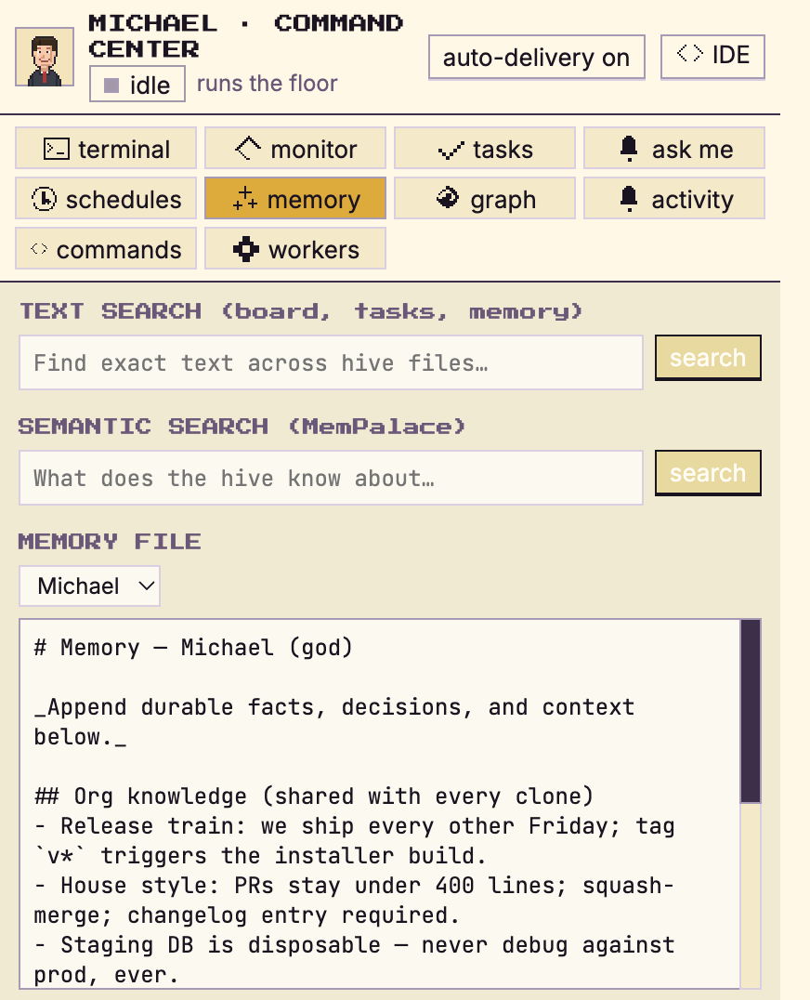
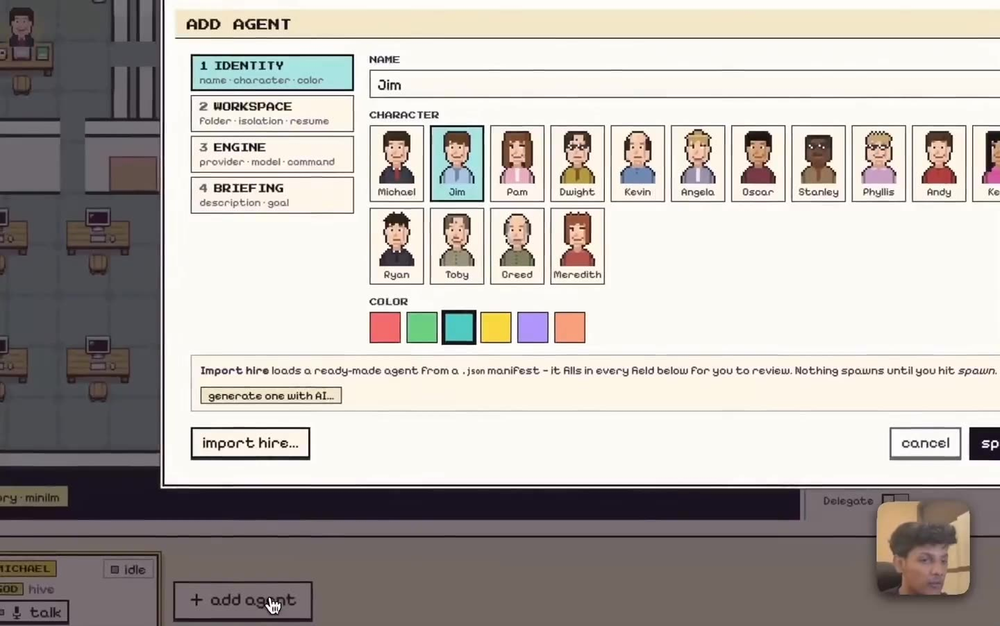
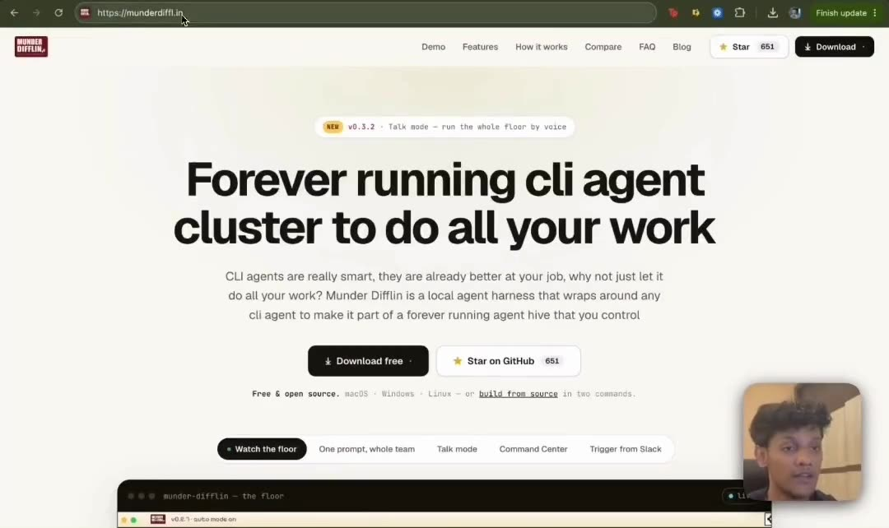

<div align="center">


# Vishwajeet Team [AI Company]

### Agent harness to run an office of your clones

<p>
  <a href="./LICENSE"></a>
  <a href="./CHANGELOG.md"></a>
  
  
</p>


**Free, open source and performant.** A multi-agent harness that works with the
subscriptions you already pay for, on their hourly limits. It turns the terminal coding CLI
you already run into a clone of you, one that keeps working while you're away and
coordinates a whole office of agents on your own machine.

Wraps [Claude Code](https://claude.com/claude-code), Antigravity (Gemini), OpenAI Codex,
**xAI Grok**, **Kimi Code**, **Gemini CLI**, **Qwen**, **OpenCode**, **Crush**,
**pi.dev**, **GitHub Copilot CLI**, and **Cursor**, with bring-your-own keys and local LLMs.
Agents that message, route, and remember, coordinated by **your clone** (Michael) and
visualized as avatars at work on a shared office floor.

<p>
  <em>Electron · React · TypeScript · Pixi.js · xterm.js · node-pty</em>
</p>

<p>
  <a href="./LICENSE"></a>
  <a href="./CHANGELOG.md"></a>
  <a href="https://github.com/Vishwajeetsrk/Team/releases"></a>
  
  
  <a href="./CONTRIBUTING.md"></a>
</p>

<br>

<!-- Inline player renders on github.com (raw URL required; relative paths only link). -->
<video src="https://github.com/Vishwajeetsrk/Team/raw/main/docs/media/hero.mp4" controls muted loop playsinline width="820">
  <a href="https://github.com/Vishwajeetsrk/Team/raw/main/docs/media/hero.mp4">▶ Watch the floor: Vishwajeet Team running a hive of Claude Code agents</a>
</video>

<br><br>

**[⬇ Download 0.4.6 for macOS, Windows or Linux](https://github.com/Vishwajeetsrk/Team/releases/latest)**

<sub>Free and local-first, no account, no paywall. Build from source below or grab a release above.</sub>

</div>

---

> [!NOTE]
> **The world's best agents. The world's worst paper company.**
> Vishwajeet Team takes the terminal-agent CLIs you already run (`claude`, `agy`, `codex`, `grok`,
> `kimi`, `qwen`, `opencode`, `crush`, `pi`, and `copilot`) and turns them
> into a self-coordinating team: each agent gets long-term memory, a mailbox, and a desk on a 2D
> office floor, and **your clone** (Michael) routes work between them while you watch. He's the
> boss of the floor; you're still the boss of him.

## Contents

- [Plans: 100% Free (Free · Pro · Team)](#plans-100-free-free--pro--team-included)
- [Supported agents](#supported-agents)
- [What it is](#what-it-is)
- [How it works](#how-it-works)
- [Features](#features)
- [Getting started](#getting-started)
- [Architecture & project structure](./docs/ARCHITECTURE.md)
- [Roadmap](#roadmap)
- [Contributing](#contributing)
- [Telemetry](#telemetry)
- [License](#license)
- [Acknowledgements](#acknowledgements)

## Plans: 100% Free (Free · Pro · Team Included)

**Vishwajeet Team [AI Company]** is completely free, local-first, and open-source under the MIT License. All features across Free, Pro, and Team are unlocked:

- **Free Core**: All terminal-agent CLIs, BYOK keys, local LLMs (Ollama / LM Studio / vLLM), and persistent computers.
- **Pro Features**: Unlimited parallel agents, autonomous execution mode, Monaco IDE, voice dictation & speech orchestration, context auto-compacting, and circuit breakers.
- **Team Capabilities**: Multi-agent delegation, agent-to-agent mailboxes, shared blackboard, scheduled triggers, and job ledgers.
- **Zero Paywalls**: No subscriptions, no license keys, no credit card required, and no telemetry required. Everything stays on your computer.

## Supported agents

**Bring the CLI you already pay for.** Every one of these runs as a real process in its own
terminal, with your existing subscription and its hourly limits. If it runs in a terminal, it
can run here.

<p>
  <a href="https://docs.claude.com/en/docs/claude-code"><kbd>Claude Code</kbd></a>
  <a href="https://github.com/openai/codex"><kbd>Codex · GPT</kbd></a>
  <a href="https://x.ai/cli"><kbd>Grok · xAI</kbd></a>
  <a href="https://www.kimi.com/code"><kbd>Kimi Code</kbd></a>
  <a href="https://github.com/google-gemini/gemini-cli"><kbd>Gemini CLI</kbd></a>
  <a href="https://antigravity.google/docs/cli-overview"><kbd>Antigravity · Gemini</kbd></a>
  <a href="https://github.com/QwenLM/qwen-code"><kbd>Qwen</kbd></a>
  <a href="https://opencode.ai/docs"><kbd>OpenCode</kbd></a>
  <a href="https://github.com/charmbracelet/crush"><kbd>Crush · Charm</kbd></a>
  <a href="https://pi.dev/docs/latest"><kbd>Pi</kbd></a>
  <a href="https://docs.github.com/copilot/concepts/agents/about-copilot-cli"><kbd>GitHub Copilot</kbd></a>
  <a href="https://cursor.com/docs/cli/install"><kbd>Cursor</kbd></a>
  <kbd>+ any custom command</kbd>
</p>

Plus **bring your own keys** and **local models** through Ollama, LM Studio or vLLM.

## What it is

Vishwajeet Team is a desktop app that wraps **real terminal-agent CLIs** as fully-capable agents,
wires them into a **hive mind**, and puts **your clone** in charge. Michael is the one agent *you*
talk to in order to get things done. Under the hood it runs the **fastest memory layer in the
world** so every agent remembers what it learns and recalls it instantly.

- **Every terminal is an agent.** Each `claude`, `agy`, `codex`, `grok`, `kimi`, `qwen`, `opencode`, `crush`, `pi`, `copilot`, or custom session runs as a real
  process in a pseudo-terminal (`node-pty`), byte-for-byte authentic, rendered with xterm.js.
- **Every agent is an avatar.** Sessions appear as characters on a Pixi.js office floor. They walk
  to stations as they work, and envelopes fly desk-to-desk when they message each other.
- **The hive coordinates them.** Agents read their memory and drain a mailbox; the router moves
  messages between inboxes; the GOD agent adjudicates, assigns, and escalates only when it needs you.
- **Memory that's instant.** A markdown-first memory layer with a semantic recall index means agents
  remember across sessions and recall in milliseconds.

## How it works

```
            you ── talk to ──►  ┌─────────────┐
                                │  GOD agent  │  orchestrator / supervisor
                                │ (Michael's  │  roster · routing · adjudication
                                │   office)   │  blackboard · task ledger
                                └──────┬──────┘
                                       │ assigns · routes · escalates
              ┌────────────────────────┼────────────────────────┐
              ▼                         ▼                         ▼
        ┌───────────┐            ┌───────────┐            ┌───────────┐
        │  agent A  │  message   │  agent B  │  message   │  agent C  │
        │ provider  │ ─────────► │ provider  │ ─────────► │ provider  │
        │  + memory │            │  + memory │            │  + memory │
        └───────────┘            └───────────┘            └───────────┘
              └──────── shared hive: memory · mailbox · blackboard · log ───────┘
```

1. **You spawn agents**: each is a normal terminal process (`claude`, `agy`, `codex`, or custom)
   with its own working directory, identity, and provider-specific lifecycle.
2. **Agents collaborate through the hive**: a local git repo of plain files. They write to their own
   `outbox/`; the harness's router delivers into recipients' `inbox/`. No agent ever touches git
   (single-committer design avoids `index.lock` corruption).
3. **The GOD agent runs the floor**: it reads every request, resolves routine ones itself (keeping
   the system fully autonomous), and only escalates *critical* items (spend, destructive ops, scope
   changes) into an approvals queue you act on.
4. **Everything is visible**: you watch avatars move, envelopes fly, and the live terminal stream;
   you can type back into any session, browse its files, and read its git history.

See [`HIVE.md`](./HIVE.md) for the full multi-agent design, [`SPEC.md`](./SPEC.md) for the
terminal/event plane, and [`DESIGN.md`](./DESIGN.md) for the visual system.

## Features

<table>
<tr>
<td width="50%" valign="middle">

### Dictation, free and local

Hold the push-to-talk key and speak into the message box mic — your words land
in the queue for the floor. Groq transcription stays off unless you add a key.
No meeting recorder here: this build has no Stapler and no Pro tier, by design.

</td>
<td width="50%" valign="middle">

### One row per agent, and it tells you everything

Agent cards carry status, engine, model, a context gauge, the ticket it is on
and the action it is taking right now, a crash strip instead of a silent
terminal, and a right click menu for the common jobs.

The Command Center tabs cover the rest: Tasks, Ask Me, Triggers and
Automations, Memory, Skills, Workers and Workforce — every surface free,
nothing tiered.

</td>
</tr>
<tr>
<td width="50%" valign="middle">

### Talk to one agent, not twelve

Michael is your clone and the only agent you brief. He assigns the work, routes the traffic, and
escalates the few things that actually need you.

</td>
<td width="50%">
  <a href="https://github.com/Vishwajeetsrk/Team/raw/main/docs/media/demo/orchestrator.mp4"></a>
</td>
</tr>
<tr>
<td width="50%" valign="middle">

### Hire an agent in a few clicks

Pick the CLI, the model and the autonomy, give it a desk, and it starts working. Import a
ready made role from the [Agent Gallery](https://github.com/Vishwajeetsrk/Team/tree/main/docs/hires) if you would rather not
start from scratch.

</td>
<td width="50%">
  
</td>
</tr>
<tr>
<td width="50%" valign="middle">

### Memory that survives the session

Every agent keeps markdown memory that is mined into a shared, searchable palace. Close the app,
come back tomorrow, and they still know what they learned.

</td>
<td width="50%">
  
</td>
</tr>
<tr>
<td width="50%" valign="middle">

### Autonomy with a leash

Set how far each agent may go on its own. Spend, scope and destructive operations come back to
you, and a circuit breaker steers, constrains, then stops anything that loops or runs away.

</td>
<td width="50%">
  
</td>
</tr>
<tr>
<td width="50%" valign="middle">

### Watch the whole floor work

Agents walk to stations as they work and envelopes fly desk to desk when they message each other.
Click any desk to read that terminal live, and type straight back into it.

</td>
<td width="50%">
  <a href="https://github.com/Vishwajeetsrk/Team/raw/main/docs/media/demo/agents.mp4"></a>
</td>
</tr>
<tr>
<td width="50%" valign="middle">

### Set up once

The onboarding wizard checks what you already have, and offers to install what is missing rather
than sending you to a docs page.

</td>
<td width="50%">
  <a href="https://github.com/Vishwajeetsrk/Team/raw/main/docs/media/demo/setup.mp4"></a>
</td>
</tr>
</table>

**The floor**
- **Every terminal is a real agent.** Claude Code, Antigravity (Gemini), OpenAI Codex, xAI Grok, Kimi Code, Gemini CLI, Qwen, OpenCode, Crush, pi.dev, GitHub Copilot CLI, Cursor, or a custom command, each in its own `node-pty` PTY, rendered with xterm.js.
- **Every agent is an avatar.** A Pixi.js office floor where agents walk to stations, envelopes fly desk to desk, and avatar state reflects real work.
- **A GOD orchestrator you talk to.** It routes tasks, adjudicates traffic, and escalates only what needs a human. Or press **Talk** and run the floor by voice.
- **Per-agent git worktrees.** Optional isolation so parallel agents never collide on branches.
- **More than one floor**. File, New Floor opens another office on its own folder, in its own window, with its own agents, board and memory. A folder only ever opens in one floor, and one licence covers them all.

**Memory & coordination**
- **The hive**: per-agent memory, atomic-file mailboxes, a shared blackboard, an append-only event log, single-committer git.
- **Semantic recall**: markdown memory mined into a shared palace, searchable from the UI, with condensation so it doesn't grow forever.
- **Enterprise Knowledge Graph**: your own documents and policies, queryable by any agent.

**Control & safety**
- **Human gates**: spend, scope, and destructive ops escalate to you. Steer mid-run or stop gracefully.
- **Circuit breaker**: a steer → constrain → stop ladder for agents that loop, storm errors, or blow their budget.
- **Budgets & telemetry**: per-agent token budgets, real cost from transcripts, a durable ledger, OTel spans, and a tool waterfall.

**Command Center**
- **Tasks with history**: kanban cards carry Q&A history, each agent has a detail sheet with what it did and when.
- Kanban tasks with dependencies, scheduled missions + heartbeat, durable job runs, live fleet monitoring, memory search, activity log, and a CI watcher.
- **Skills**: what every agent can already do across Claude Code, OpenCode and Codex — installed, project and bundled — with agent bindings, plus a browsable catalog with search, filters, install and uninstall.
- **Workforce**: every roster agent read as a specialist profile — staffed or listed inert with its gap named — plus a skill matcher that names its pick.
- **Workers**: live temp workers with one-job spawn, and a job history where every run is accounted for.
- **Built-in Monaco IDE**: file tree, editor tabs, save, plus CHANGES · HISTORY · COMPARE git rails with commit graph, diffs, branch compare, and guarded checkout. All fs/git access brokered through main.

**Getting work in and out**
- **Slack & webhooks**: message a channel or POST a webhook; Michael can spawn an ephemeral worker, reply in-thread, and tear it down.
- **Shareable hires + Agent Gallery**: import a role from a `munderdifflin://hire` link; import only pre-fills the form, a human still spawns it. Browse roles in [`docs/hires/`](./docs/hires/).
- **Local transcription and dictation**: push-to-talk into the message box mic, with Groq transcription only if you add a key. No meeting recorder, no Stapler — this fork has no Pro tier.
- **BYOK keys + local LLMs**: per-provider keys in a write-only secret broker, plus Ollama / LM Studio / vLLM base URLs. Guides: [open models](https://munderdiffl.in/blog/run-munder-difflin-on-open-models/) · [Mac Mini](https://munderdiffl.in/blog/run-munder-difflin-on-a-mac-mini/).
- **Updates in one click**: the title-bar badge runs the real update. It downloads the build for your machine, then restarts and installs it, and it reads `latest` once a check confirms you are current. A manual download is the fallback for when the updater cannot fetch the build itself. The first run afterwards opens that release's notes as a designed page rather than a version number.
- **Your language**: English, Simplified Chinese and Arabic, with right to left layout for Arabic. English is the default and nothing changes until you pick another one in Settings. The app does not read your OS locale. All three app fonts ship inside the bundle, so nothing is fetched at boot.
> [!NOTE]
> **Status: v0.4.6 — this fork.** Free and local-first: no account, no paywall,
> no Pro tier. Everything runs on your machine — agents, memory, triggers,
> integrations, skills. Updates never apply unless you turn them on in
> Settings → General (upstream releases are a different product and are never
> offered by default).

<div align="right">(<a href="#munder-difflin">↑ back to top</a>)</div>

## Getting started

### Download the app

**Most people want this one.** This fork is free and local-first: no account, no paywall.
Grab a build from the [releases page](https://github.com/Vishwajeetsrk/Team/releases/latest),
open it, and the wizard takes you the rest of the way. You do not need Node, a toolchain, or this
repository.

You do still need at least one agent CLI on your machine. A missing CLI shows as a card in the
agent's terminal with install help, and **Settings → Prerequisites** lists the rest.

### Build from source

Everything below is for developers and for people who want to run an unreleased build.

### Prerequisites

- **macOS, Windows, or Linux**.
- **Node.js 18+** and npm.
- A **C/C++ toolchain** for `node-pty`'s native addon. On macOS, install Xcode Command Line Tools:
  ```bash
  xcode-select --install
  ```
- At least one supported agent CLI on your `PATH`, one of **[Claude Code](https://claude.com/claude-code)**
  (`claude`, the default), **Antigravity** (`agy`), **OpenAI Codex** (`codex`), **xAI Grok** (`grok`),
  **Kimi Code** (`kimi`), **Gemini CLI** (`gemini`), **Qwen** (`qwen`), **OpenCode** (`opencode`),
  **Crush** (`crush`), **pi.dev** (`pi`), **GitHub Copilot** (`copilot`), or **Cursor** (`cursor-agent`).
  Most missing CLIs self-heal: the harness runs the installer in the
  terminal and continues into the new binary.
- *Optional:* **your own API keys and local LLMs** in **Settings → AI Engines** (Ollama / LM Studio / vLLM).
- *Optional:* the semantic memory index for instant cross-session recall. Markdown memory works without it.

### Install & run

```bash
git clone https://github.com/Vishwajeetsrk/Team.git
cd munder-difflin
npm install        # postinstall rebuilds node-pty against Electron's ABI
npm run dev        # launches the Electron app with hot reload
```

On first launch you'll go through the onboarding wizard, then land on the floor. Use **Add agent** to
spawn your first session. The GOD agent seats itself in Michael's office automatically.

### Other scripts

```bash
npm run build      # production build via electron-vite
npm run preview    # preview the production build
npm run typecheck  # type-check the node (main/preload) and web (renderer) projects
```

> If `node-pty` fails to load after an Electron upgrade, re-run `npm install` (the `postinstall` hook
> runs `electron-rebuild` against the current Electron ABI).

## Architecture

Two data planes feed one renderer: a **terminal plane** that owns the PTYs, the filesystem and git,
and an **event plane** that runs the hive, the hook server and the router. The renderer talks to
both only through a typed bridge.

**The full diagrams, the module by module project structure, and the design system live in
[`docs/ARCHITECTURE.md`](./docs/ARCHITECTURE.md).** They moved out of this file so it can explain
the product rather than the codebase. Also see [`HIVE.md`](./HIVE.md) for the multi-agent design,
[`SPEC.md`](./SPEC.md) for the terminal and event plane, and [`DESIGN.md`](./DESIGN.md) for the
visual system.

<div align="right">(<a href="#munder-difflin">↑ back to top</a>)</div>

## Roadmap

Shipped in **this fork (v0.4.6 + local lanes)**: push-to-talk dictation into the
message box, agent cards with status/engine/model/context gauge, missing-CLI
help from inside the app, Ask Me on every inbox, more than one floor on one
machine, twelve agent engines with BYOK keys and local LLMs, voice
orchestration, the hive (memory · mailboxes · blackboard · event log), Command
Center with kanban and weekday schedules plus triggers, jobs ledger, workforce
and workers tabs, a built-in Monaco IDE with git rails, integrations registry
+ secret broker with free and approval-gated connectors, Slack-spawned and
operator-spawned temp workers, shareable hires, observability and the circuit
breaker, durable persistence, session resume, one-click updates (opt-in only),
a Skills browser with agent bindings, a live Prerequisites check, cost
reporting folded from the ledger, semantic memory, and a learn loop that turns
your answers into agent preferences. Full history in [`CHANGELOG.md`](./CHANGELOG.md).

Next up:

- [ ] **More chat integrations**: Telegram and richer chat bridges that pipe a channel into Michael's queue and route replies back out.
- [ ] **More engines & integration templates**: keep growing the engine roster and the integrations registry.
- [ ] **Fuller avatar coverage**: drive the remaining station visits and tool-bubbles entirely from real hook events.
- [ ] **Durable layout & command history**: extend persistence to agent layout and per-session history.

<div align="right">(<a href="#vishwajeet-team-ai-company">↑ back to top</a>)</div>

## Contributing

Contributions are welcome. This is pre-release software with a lot of surface area. Start with
[`CONTRIBUTING.md`](./CONTRIBUTING.md). The short version: fork, `npm install && npm run dev`, keep
`npm run typecheck` green, and **derive any new UI from [`DESIGN.md`](./DESIGN.md) tokens**. Good
first areas: wiring real hook events, the add-agent flow, the config drawer, and cross-platform work.

> [!IMPORTANT]
> **Every pull request must show a before and an after**: screenshots, or a recording when the
> thing moves, under the `### Before` and `### After` headings in the PR template. This is checked
> automatically and a PR without it does not merge. "My change has no UI" is not an exemption; it
> just changes what the evidence looks like. See
> [Evidence is mandatory](./CONTRIBUTING.md#evidence-is-mandatory).

Questions or bugs? Open an issue: **<https://github.com/Vishwajeetsrk/Team/issues>**.

**Looking for somewhere to start?** Browse the open issues — small, self-contained
work with a clear finish line is marked for newcomers.

## Telemetry

Official builds send a **small set of anonymous usage events** (app opened, agent spawned, feature
used), never prompts, code, file paths, or agent output. The complete event list, the anonymity
guarantees, and the three ways to opt out (Settings toggle, `DO_NOT_TRACK`, or building from
source, forks compile with no key and send nothing) are documented in
[`TELEMETRY.md`](./TELEMETRY.md).

## License

> [!IMPORTANT]
> **Asset licensing.** The bundled pixel art (tilesets and maps) is **Modern Interiors - RPG Tileset
> [16X16]** by [LimeZu](https://limezu.itch.io/moderninteriors), used under the **Complete Version
> licence**, which permits editing and use in commercial and non-commercial projects. **Credit to
> LimeZu is required by that licence** and must stay in place. The Office cast is not LimeZu art. It
> is drawn procedurally in `portraitArt.ts`. See
> [`src/renderer/src/assets/ATTRIBUTION.md`](./src/renderer/src/assets/ATTRIBUTION.md).

The **source code** is licensed under the **MIT License** by **Vishwajeet**. See [`LICENSE`](./LICENSE). The MIT grant
covers the code only; the bundled pixel art is licensed separately from LimeZu and is carved out in
[`LICENSE-ASSETS`](./LICENSE-ASSETS). *Vishwajeet Team* is an independent, local-first multi-agent OS,
namechecked above for searchability only. *Munder Difflin* is an affectionate parody and is not
affiliated with NBC's *The Office* or Dunder Mifflin.

## Acknowledgements

- [LimeZu](https://limezu.itch.io/) for the *Modern Interiors* pixel-art tilesets (Complete Version licence).
- [`shahar061/the-office`](https://github.com/shahar061/the-office) for the office tileset/map vendoring.
- [Pixi.js](https://pixijs.com/) · [xterm.js](https://xtermjs.org/) · [node-pty](https://github.com/microsoft/node-pty) · [electron-vite](https://electron-vite.org/) · [CodeMirror](https://codemirror.net/) for the libraries this is built on.
- [Remotion](https://www.remotion.dev/) for the landing page's animated "how it works" clips (`landing-remotion/`).
- *The Office* (US) for Munder Difflin, Inc.
